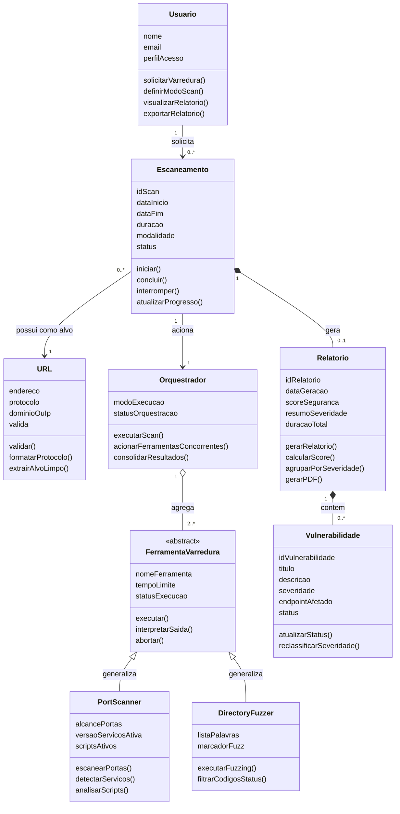

# Diagrama de Classes de Análise — VulScanner

> **Disciplina:** Análise e Projeto de Sistemas (UNIFRAN)  
> **Artefato:** Diagrama de Classes de Análise (Modelo Conceitual de Domínio)  
> **Modo de Operação:** Baseline Metodológico (fundamentado em WAZLAWICK, PRESSMAN e nos requisitos consolidados do projeto)

---

## 📂 1. Relatório de Varredura e Contexto

* **Material Oficial / Orientações do Professor:** [Baseline / Ausente no diretório]
* **Artefatos Anteriores Integrados:** `ANALISE_REQUISITOS.md` (RF-01 a RF-06, RNF-01 a RNF-04, RN-01 a RN-03) e base de código funcional (`app/`, `backend/`, `pages/report.tsx`).
* **Objetivo da Etapa:** Construir o modelo de **Classes de Análise** do VulScanner, focando no **o que** o sistema faz conceitualmente (alto nível), sem antecipar detalhes técnicos de implementação (como tipos primitivos rígidos, visibilidade `+ / -`, DTOs ou Controllers).

---

## 🔍 2. Passo 1 — Identificação de Classes e Atributos

Aplicando as heurísticas da Engenharia de Software e da metodologia da disciplina:
* **Classe:** Substantivo que possui identidade, estado próprio (múltiplos atributos) e comportamento relevante no domínio.
* **Atributo:** Propriedade simples ou dado atômico que descreve uma classe.
* **Descarte:** Termos que representam dados técnicos de protocolo (ex: JSON, Payload), componentes de interface gráfica pura (ex: Botão, Switch) ou sinônimos redundantes.

### Tabela de Extração e Heurística dos Substantivos Candidatos

| Substantivo Candidato | Classificação | Justificativa no Domínio |
| :--- | :--- | :--- |
| **Usuário / Pentester** | **Classe de Análise** | Ator primário com papel ativo no domínio; solicita varreduras, configura parâmetros e analisa resultados. |
| **URL / Alvo** | **Classe de Análise** | Entidade central de entrada do sistema. Possui regras de negócio estritas de sanitização, decomposição e validação sintática (RN-01). |
| **Escaneamento (Scan)** | **Classe de Análise** | Representa o ciclo de vida e a sessão da auditoria (data, tipo, duração, status). Conecta o alvo às ferramentas. |
| **Orquestrador** | **Classe de Análise** | Classe de controle/coordenação conceitual; responsável por gerenciar a execução concorrente das ferramentas de inspeção (RF-04). |
| **Ferramenta de Varredura** | **Classe de Análise (Superclasse)** | Abstração que generaliza as ferramentas externas de análise de vulnerabilidade (RF-02, RF-03). |
| **PortScanner (Nmap)** | **Classe de Análise (Subclasse)** | Especialização da ferramenta de varredura voltada à descoberta de portas, serviços de rede e scripts (RF-02). |
| **DirectoryFuzzer (FFuf)** | **Classe de Análise (Subclasse)** | Especialização da ferramenta de varredura voltada ao fuzzing de diretórios web via listas de palavras (RF-03). |
| **Relatório (Report)** | **Classe de Análise** | Entidade que consolida o resultado do escaneamento, agrega achados e calcula o Score de Segurança (RF-05). |
| **Vulnerabilidade (Finding)** | **Classe de Análise** | Representa cada falha de segurança detectada individualmente (severidade, endpoint, evidências, status de mitigação). |
| *AliveProber (HTTPX)* | **Classe Proposta/Pendente** | Ferramenta de verificação de disponibilidade HTTP prevista no pipeline visual do frontend, mas pendente no backend (RF-06). |
| *Wordlist* | **Atributo** | Descartada como classe separada na fase de análise; atua como atributo configurador do `DirectoryFuzzer` (`fast_fuzzing.txt` vs `deep_fuzzing.txt`). |
| *Botão / Tela / Input* | **Descartado** | Elementos da camada de apresentação/UI; não pertencem ao modelo conceitual de domínio. |
| *Payload / JSON / Subprocesso* | **Descartado** | Detalhes de implementação e transporte técnico; serão tratados futuramente nas Classes de Projeto. |

---

## ⚙️ 3. Passo 2 — Definição de Atributos e Métodos em Alto Nível

> **Diretriz Metodológica (Análise vs. Projeto):**  
> Nesta fase de análise conceitual, os atributos não possuem visibilidade explícita (`+`, `-`, `#`) nem tipos estritos de linguagens (`str`, `dict`, `int`), e os métodos são definidos como intenções funcionais (ações no infinitivo), sem tipagem de retorno.

### 1. `Usuario`
* **Atributos:** `nome`, `email`, `perfilAcesso`
* **Métodos:**
  * `solicitarVarredura()`
  * `definirModoScan()`
  * `visualizarRelatorio()`
  * `exportarRelatorio()`

### 2. `URL` (Alvo)
* **Atributos:** `endereco`, `protocolo`, `dominioOuIp`, `valida`
* **Métodos:**
  * `validar()`
  * `formatarProtocolo()`
  * `extrairAlvoLimpo()`

### 3. `Escaneamento`
* **Atributos:** `idScan`, `dataInicio`, `dataFim`, `duracao`, `modalidade` *(Fast / Deep)*, `status` *(Em Andamento / Concluído / Falha)*
* **Métodos:**
  * `iniciar()`
  * `concluir()`
  * `interromper()`
  * `atualizarProgresso()`

### 4. `Orquestrador`
* **Atributos:** `modoExecucao`, `statusOrquestracao`
* **Métodos:**
  * `executarScan()`
  * `acionarFerramentasConcorrentes()`
  * `consolidarResultados()`

### 5. `FerramentaVarredura` *(Superclasse Abstrata)*
* **Atributos:** `nomeFerramenta`, `tempoLimite`, `statusExecucao`
* **Métodos:**
  * `executar()`
  * `interpretarSaida()`
  * `abortar()`

### 6. `PortScanner` *(Especialização de FerramentaVarredura)*
* **Atributos:** `alcancePortas` *(Fast: portas comuns / Deep: todas)*, `versaoServicosAtiva`, `scriptsAtivos`
* **Métodos:**
  * `escanearPortas()`
  * `detectarServicos()`
  * `analisarScripts()`

### 7. `DirectoryFuzzer` *(Especialização de FerramentaVarredura)*
* **Atributos:** `listaPalavras` *(fast_fuzzing.txt / deep_fuzzing.txt)*, `marcadorFuzz`
* **Métodos:**
  * `executarFuzzing()`
  * `filtrarCodigosStatus()`

### 8. `Relatorio`
* **Atributos:** `idRelatorio`, `dataGeracao`, `scoreSeguranca`, `resumoSeveridade`, `duracaoTotal`
* **Métodos:**
  * `gerarRelatorio()`
  * `calcularScore()`
  * `agruparPorSeveridade()`
  * `gerarPDF()`

### 9. `Vulnerabilidade`
* **Atributos:** `idVulnerabilidade`, `titulo`, `descricao`, `severidade` *(Crítico / Alto / Médio / Baixo / Info)*, `endpointAfetado`, `status` *(Aberto / Resolvido)*
* **Métodos:**
  * `atualizarStatus()`
  * `reclassificarSeveridade()`

---

## 🔗 4. Passo 3 — Mapeamento de Relacionamentos e Multiplicidades

Aplicando a árvore de decisão metodológica da disciplina:

```text
1. A é um tipo de B?
   ↓ Sim → Generalização (Herança)
   ↓ Não

2. Existe relação Todo-Parte?
   ↓ Não → Associação Simples
   ↓ Sim

3. A parte sobrevive sem o Todo?
   ↓ Sim → Agregação (◇)
   ↓ Não → Composição (◆)
```

### Análise dos Relacionamentos

1. **`Usuario` 1 ─── 0..* `Escaneamento` (Associação Simples)**
   * **Justificativa:** Relação não estrutural. O usuário solicita zero ou vários escaneamentos ao longo do tempo. Um escaneamento está associado a exatamente 1 usuário que o disparou.
2. **`Escaneamento` 0..* ─── 1 `URL` (Associação Simples)**
   * **Justificativa:** O escaneamento tem como alvo uma URL específica. Uma mesma URL pode ser alvo de múltiplos escaneamentos em momentos distintos.
3. **`Escaneamento` 1 ─── 1 `Orquestrador` (Associação Simples)**
   * **Justificativa:** Cada sessão de escaneamento aciona e é coordenada por 1 orquestrador responsável por seu ciclo.
4. **`Orquestrador` 1 ◇─── 2..* `FerramentaVarredura` (Agregação)**
   * **Justificativa Todo-Parte:** O orquestrador agrega e coordena ferramentas para realizar a varredura.
   * **Sobrevivência da Parte:** As ferramentas (Nmap, FFuf) são utilitários autônomos que existem independentemente de uma instância de orquestrador. Logo, é uma **Agregação**.
5. **`PortScanner` e `DirectoryFuzzer` ──▷ `FerramentaVarredura` (Generalização)**
   * **Justificativa:** Relação do tipo *"é um tipo de"*. Tanto o `PortScanner` quanto o `DirectoryFuzzer` são tipos especializados de `FerramentaVarredura`, herdando seus atributos e comportamentos base.
6. **`Escaneamento` 1 ◆─── 0..1 `Relatorio` (Composição)**
   * **Justificativa Todo-Parte:** O relatório é o resultado direto e indissociável de um escaneamento.
   * **Sobrevivência da Parte:** Um relatório não possui existência independente fora do escaneamento que o gerou. Se o escaneamento for excluído, o relatório perde a razão de existir. Logo, é uma **Composição**.
   * **Multiplicidade:** 1 escaneamento possui 0 relatórios enquanto está em processamento e 1 relatório quando finalizado.
7. **`Relatorio` 1 ◆─── 0..* `Vulnerabilidade` (Composição)**
   * **Justificativa Todo-Parte:** O relatório agrega e contém os achados de vulnerabilidade.
   * **Sobrevivência da Parte:** O registro do achado/vulnerabilidade pertence especificamente àquela inspeção auditada. Se o relatório for descartado, seus registros de vulnerabilidade associados são destruídos. Logo, é uma **Composição**.
   * **Multiplicidade:** 1 relatório pode conter de 0 a muitas vulnerabilidades (alvo 100% seguro = 0). Cada vulnerabilidade registrada pertence a 1 relatório.

---

## 📊 5. Passo 4 — Diagrama de Classes de Análise

### Representação Visual (Mermaid)



---

## 🎯 6. Rastreabilidade com os Requisitos Levantados

| Requisito / Regra | Classes de Análise Envolvidas | Como é Atendido no Modelo |
| :--- | :--- | :--- |
| **RF-01** (Submissão de Alvo e Tipo) | `Usuario`, `URL`, `Escaneamento` | `Usuario` submete `URL` invocando `validar()` e instanciando `Escaneamento` com a `modalidade` escolhida. |
| **RF-02** (Execução do Nmap) | `PortScanner`, `FerramentaVarredura` | `PortScanner` especializa `FerramentaVarredura`, executando varredura de portas e detecção de versões. |
| **RF-03** (Execução do FFuf) | `DirectoryFuzzer`, `FerramentaVarredura` | `DirectoryFuzzer` especializa `FerramentaVarredura`, consumindo as wordlists adequadas ao tipo de scan. |
| **RF-04** (Execução Concorrente) | `Orquestrador`, `FerramentaVarredura` | `Orquestrador` agrega as ferramentas e dispara o método `acionarFerramentasConcorrentes()`. |
| **RF-05** (Relatório Consolidado) | `Orquestrador`, `Relatorio`, `Vulnerabilidade` | `Orquestrador` consolida dados em `Relatorio`, que compõe os achados em instâncias de `Vulnerabilidade`. |
| **RN-01** (Validação de Alvo) | `URL` | Método `validar()` assegura conformidade de domínio/IP antes de disparar o escaneamento. |
| **RN-02 / RN-03** (Fast vs Deep) | `Escaneamento`, `PortScanner`, `DirectoryFuzzer` | O atributo `modalidade` direciona os parâmetros de `alcancePortas` e a `listaPalavras` utilizada. |

---

## 🚀 7. Transição Futura: Da Análise para o Projeto

Conforme previsto no plano acadêmico da disciplina, no segundo momento do semestre estas classes de análise serão refinadas para **Classes de Projeto**:
1. **Tipagem e Visibilidade:** Adição de tipos estritos (ex: `String`, `DateTime`, `int`, `List<Vulnerabilidade>`) e visibilidade UML (`+`, `-`, `#`).
2. **Padrões de Projeto (GoF):**
   * *Strategy / Factory:* Para instanciar as ferramentas e orquestradores dinamicamente conforme o tipo de scan.
   * *DTOs e Schemas:* Modelagem formal dos payloads da API FastAPI (`buttonPayload`, `ScanResponse`).
3. **Diagramas de Sequência:** Cada método das classes de análise (`executarScan()`, `acionarFerramentasConcorrentes()`, `consolidarResultados()`) servirá de base direta para as mensagens e linhas de vida dos diagramas de sequência.
