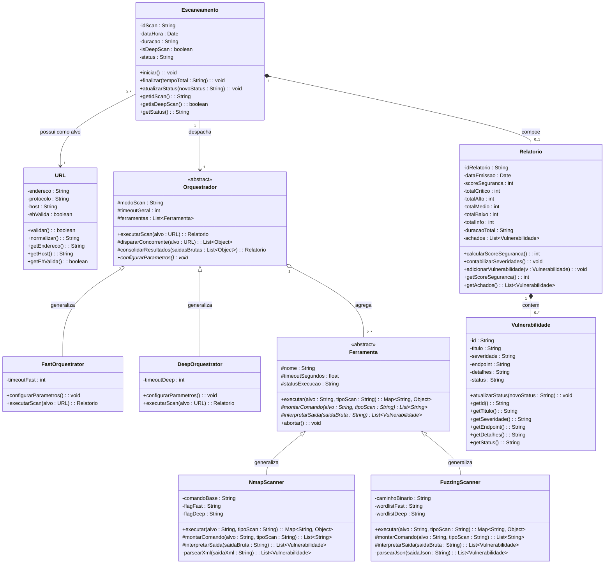

# Diagrama de Classes de Projeto — VulScanner

> **Disciplina:** Análise e Projeto de Sistemas (UNIFRAN)  
> **Artefato:** Diagrama de Classes de Projeto (Arquitetura de Classes do Projeto)  
> **Escopo das Classes:** Estritamente as classes de domínio do projeto: **URL, Escaneamento, Orquestrador (Fast/Deep), Ferramenta (Nmap/FFuf), Relatório e Vulnerabilidade**.  
> **Alinhamento de Domínio:** O sistema é aberto e o usuário não se identifica (sem entidade `Usuario`); o operador apenas informa a URL alvo e seleciona a modalidade de varredura (*Fast* ou *Deep*).

---

## 📐 1. Especificação Técnica Formal das Classes de Projeto

Todas as classes exibem rigorosamente os **3 compartimentos formais da UML**:
1. **Nome da Classe**
2. **Atributos:** `[visibilidade] [nomeAtributo] : [Tipo]`
3. **Métodos:** `[visibilidade] [nomeMetodo]([parâmetros tipados]) : [TipoRetorno]`

Visibilidades: `+` público (*public*), `-` privado (*private*), `#` protegido (*protected*).

---

### 1. `URL`
*Representa o alvo da auditoria, encapsulando validação de formato e higienização de protocolo.*
* **Atributos:**
  * `- endereco : String`
  * `- protocolo : String`
  * `- host : String`
  * `- ehValida : boolean`
* **Métodos:**
  * `+ validar() : boolean`
  * `+ normalizar() : String`
  * `+ getEndereco() : String`
  * `+ getHost() : String`
  * `+ getEhValida() : boolean`

---

### 2. `Escaneamento`
*Representa o ciclo de vida e a sessão temporal de uma auditoria.*
* **Atributos:**
  * `- idScan : String`
  * `- dataHora : Date`
  * `- duracao : String`
  * `- isDeepScan : boolean`
  * `- status : String`
* **Métodos:**
  * `+ iniciar() : void`
  * `+ finalizar(tempoTotal : String) : void`
  * `+ atualizarStatus(novoStatus : String) : void`
  * `+ getIdScan() : String`
  * `+ getIsDeepScan() : boolean`
  * `+ getStatus() : String`

---

### 3. `Orquestrador` *(<<abstract>>)*
*Superclasse abstrata de coordenação assíncrona e concorrente das ferramentas de varredura.*
* **Atributos:**
  * `# modoScan : String`
  * `# timeoutGeral : int`
  * `# ferramentas : List<Ferramenta>`
* **Métodos:**
  * `+ executarScan(alvo : URL) : Relatorio`
  * `# dispararConcorrente(alvo : URL) : List<Object>`
  * `# consolidarResultados(saidasBrutas : List<Object>) : Relatorio`
  * `+ abstract configurarParametros() : void`

---

### 4. `FastOrquestrator`
*Especialização do orquestrador para o modo rápido (RN-02).*
* **Atributos:**
  * `- timeoutFast : int`
* **Métodos:**
  * `+ configurarParametros() : void`
  * `+ executarScan(alvo : URL) : Relatorio`

---

### 5. `DeepOrquestrator`
*Especialização do orquestrador para o modo profundo/exaustivo (RN-03).*
* **Atributos:**
  * `- timeoutDeep : int`
* **Métodos:**
  * `+ configurarParametros() : void`
  * `+ executarScan(alvo : URL) : Relatorio`

---

### 6. `Ferramenta` *(<<abstract>>)*
*Superclasse abstrata que padroniza a execução de binários externos de inspeção.*
* **Atributos:**
  * `# nome : String`
  * `# timeoutSegundos : float`
  * `# statusExecucao : String`
* **Métodos:**
  * `+ executar(alvo : String, tipoScan : String) : Map<String, Object>`
  * `# abstract montarComando(alvo : String, tipoScan : String) : List<String>`
  * `# abstract interpretarSaida(saidaBruta : String) : List<Vulnerabilidade>`
  * `+ abortar() : void`

---

### 7. `NmapScanner`
*Especialização da ferramenta de varredura voltada ao Port Scanning de rede (Nmap).*
* **Atributos:**
  * `- comandoBase : String`
  * `- flagFast : String`
  * `- flagDeep : String`
* **Métodos:**
  * `+ executar(alvo : String, tipoScan : String) : Map<String, Object>`
  * `# montarComando(alvo : String, tipoScan : String) : List<String>`
  * `# interpretarSaida(saidaBruta : String) : List<Vulnerabilidade>`
  * `- parsearXml(saidaXml : String) : List<Vulnerabilidade>`

---

### 8. `FuzzingScanner`
*Especialização da ferramenta de varredura voltada ao fuzzing de diretórios web (FFuf).*
* **Atributos:**
  * `- caminhoBinario : String`
  * `- wordlistFast : String`
  * `- wordlistDeep : String`
* **Métodos:**
  * `+ executar(alvo : String, tipoScan : String) : Map<String, Object>`
  * `# montarComando(alvo : String, tipoScan : String) : List<String>`
  * `# interpretarSaida(saidaBruta : String) : List<Vulnerabilidade>`
  * `- parsearJson(saidaJson : String) : List<Vulnerabilidade>`

---

### 9. `Relatorio`
*Consolidação da auditoria contendo métricas, Security Score e achados identificados.*
* **Atributos:**
  * `- idRelatorio : String`
  * `- dataEmissao : Date`
  * `- scoreSeguranca : int`
  * `- totalCritico : int`
  * `- totalAlto : int`
  * `- totalMedio : int`
  * `- totalBaixo : int`
  * `- totalInfo : int`
  * `- duracaoTotal : String`
  * `- achados : List<Vulnerabilidade>`
* **Métodos:**
  * `+ calcularScoreSeguranca() : int`
  * `+ contabilizarSeveridades() : void`
  * `+ adicionarVulnerabilidade(v : Vulnerabilidade) : void`
  * `+ getScoreSeguranca() : int`
  * `+ getAchados() : List<Vulnerabilidade>`

---

### 10. `Vulnerabilidade`
*Registro estruturado de cada falha ou achado individual de segurança.*
* **Atributos:**
  * `- id : String`
  * `- titulo : String`
  * `- severidade : String`
  * `- endpoint : String`
  * `- detalhes : String`
  * `- status : String`
* **Métodos:**
  * `+ atualizarStatus(novoStatus : String) : void`
  * `+ getId() : String`
  * `+ getTitulo() : String`
  * `+ getSeveridade() : String`
  * `+ getEndpoint() : String`
  * `+ getDetalhes() : String`
  * `+ getStatus() : String`

---

## 🔗 2. Mapeamento de Relacionamentos e Multiplicidades

| Origem | Notação UML | Destino | Tipo de Relação | Justificativa no Domínio do VulScanner |
| :--- | :---: | :--- | :--- | :--- |
| `Escaneamento` | `0..* ──> 1` | `URL` | **Associação Dirigida** | Cada escaneamento referencia exatamente 1 URL alvo validada. A mesma URL pode ser alvo de múltiplos escaneamentos ao longo do tempo. |
| `Escaneamento` | `1 ──> 1` | `Orquestrador` | **Associação Dirigida** | Toda sessão de escaneamento aciona e despacha a execução para 1 orquestrador. |
| `FastOrquestrator` | `──▷` | `Orquestrador` | **Generalização** | `FastOrquestrator` é uma especialização de `Orquestrador` (*é um tipo de*). |
| `DeepOrquestrator` | `──▷` | `Orquestrador` | **Generalização** | `DeepOrquestrator` é uma especialização de `Orquestrador` (*é um tipo de*). |
| `Orquestrador` | `1 ◇──> 2..*` | `Ferramenta` | **Agregação ($\diamond$)** | O orquestrador agrega e coordena ferramentas independentes (Nmap e FFuf). As ferramentas continuam existindo fora do ciclo do orquestrador. |
| `NmapScanner` | `──▷` | `Ferramenta` | **Generalização** | `NmapScanner` é uma especialização de `Ferramenta` (*é um tipo de*). |
| `FuzzingScanner` | `──▷` | `Ferramenta` | **Generalização** | `FuzzingScanner` é uma especialização de `Ferramenta` (*é um tipo de*). |
| `Escaneamento` | `1 ◆──> 0..1` | `Relatorio` | **Composição ($\blacklozenge$)** | O relatório é parte integrante do escaneamento. Não existe relatório sem o escaneamento que o gerou. Multiplicidade `0..1` (inexistente antes da conclusão). |
| `Relatorio` | `1 ◆──> 0..*` | `Vulnerabilidade` | **Composição ($\blacklozenge$)** | As vulnerabilidades constituem partes estruturais do relatório gerado. Se o relatório for excluído, os achados daquele contexto são eliminados. |

---

## 📊 3. Diagrama de Classes de Projeto (UML Mermaid)

---

## 🎨 4. Guia Rápido para Montagem no Draw.io

Para montar este diagrama no **Draw.io**:
1. **Caixas de Classe (UML Class):** Use a forma com 3 compartimentos (Nome no topo, Atributos no centro, Métodos na base).
2. **Generalização ($\triangle$):** Linha contínua com ponta triangular branca vazada apontando para as superclasses abstratas (`Orquestrador` e `Ferramenta`).
3. **Agregação ($\diamond$):** Linha contínua com losango branco vazado na extremidade de `Orquestrador`, apontando para `Ferramenta` com multiplicidade `2..*`.
4. **Composição ($\blacklozenge$):** Linha contínua com losango preto preenchido na extremidade de `Escaneamento` (apontando para `Relatorio`) e de `Relatorio` (apontando para `Vulnerabilidade`).
5. **Associação Dirigida ($\rightarrow$):** Linha contínua com seta simples de `Escaneamento` para `URL` e de `Escaneamento` para `Orquestrador`.
